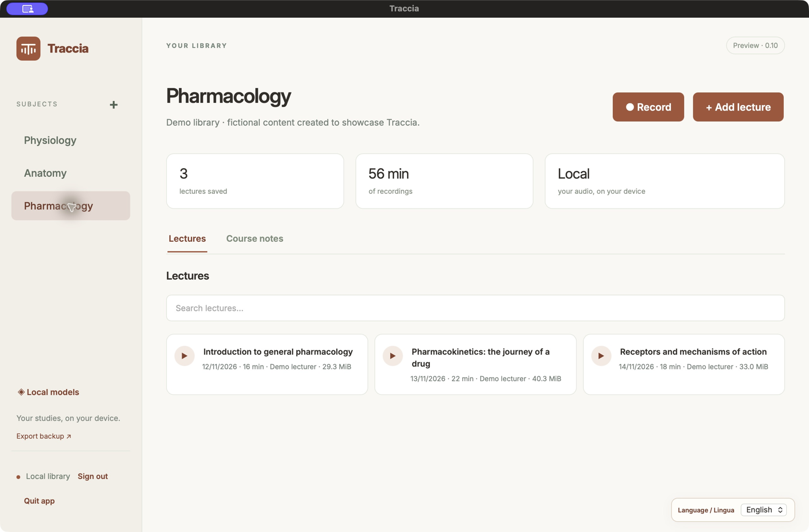
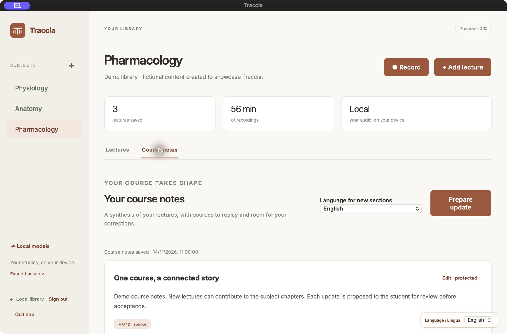

<div align="center">


### Turn your lectures into a study library. On your own computer.

Clearer audio. Searchable transcripts. Course notes that grow with each lecture.

**[Get started](#get-started)** · **[Features](#from-recording-to-study-notes)** · **[Documentation](docs/getting-started.md)** · **[Roadmap](docs/roadmap.md)** · **[Issues](https://github.com/ico88/Traccia/issues)**

**English** · [Italiano](README.it.md)

</div>

Traccia is an experimental study app for university students. Organize recordings by subject, improve listening, transcribe lectures and prepare updates to your course notes, with references back to the source audio.

Models run on your Mac or your own server. The standard workflow needs no account, inference API token or subscription. Internet is needed to install dependencies and download models; inference can then run offline.

> **Preview 0.10.** Current code lives on [`sviluppo`](https://github.com/ico88/Traccia/tree/sviluppo). AI output needs review. Development Mac builds are not notarized; no stable Mac download has been published in this repository yet.



*Real app screenshot with a fictional demo archive and synthetic silent recordings. No personal lecture data. This capture shows the English interface; Italian is also available.*

## One app, more than one language

Choose **English or Italian** for the interface; your preference is remembered on this device. Select **Italian, English or automatic detection** for transcription, and **English or Italian** for new course-note sections. These settings are independent: changing the interface never translates or rewrites your saved lectures. Some technical diagnostics and generated image labels still use their original language.

## From recording to study notes

| Feature | What you can do |
|---|---|
| Record or drop a file | Import MP3, WAV, M4A and FLAC, or record your microphone with pause and recovery of saved chunks. |
| Improve listening | Reduce background noise with local GTCRN, adjust gain and compare the original and enhanced audio at the same position. |
| Transcribe and review | Use Whisper Turbo with timestamps, search terms, replay passages and save corrections as separate revisions. |
| Build course notes | Prepare topic-based updates from new lectures, inspect changes and sources, then approve each changed section. Manual edits stay protected. |
| Add visual material | Attach images with captions and generate a chapter map. Export Markdown/ZIP or print to PDF. |
| Keep your archive | Preserve original recordings and create verified backups including completed derivatives, images and speaker edits. |

**Experimental audio tools:** speaker analysis with editable roles, and VoxLock extraction using a 3–30 second sample of the lecturer’s voice. Accuracy, speed and listening quality depend on the recording. These tools do not guarantee clean separation or removal of reverberation.

Microphone recording is followed by transcription; live transcription is not implemented. Open recording drafts are not part of backups: finish and import them first.

## Notes that grow with the course

Add a lecture to a subject, review its transcript and prepare an update to the course notes. Traccia proposes additions to relevant chapters and flags possible conflicts. You review the sources and approve changed sections before accepting a proposal.



*Manually written demo text in the real app, not an example of AI summarization quality.*

Topic consolidation is experimental. Source links make verification possible; they do not certify the correctness of generated text. [How it works →](docs/dynamic-notes.md)

## Get started

The reference development machine is an **Apple M4 with 24 GB unified memory**. Apple Silicon Macs use a dedicated WebKit window. Intel Macs are excluded; minimum requirements have not been certified.

Install **Python 3.11+**, Git and Xcode Command Line Tools, then:

```sh
git clone --branch sviluppo https://github.com/ico88/Traccia.git
cd Traccia
python3 -m venv .venv
source .venv/bin/activate
python -m pip install -r requirements-dev.txt
python -m pip install cmake==4.4.4
python scripts/setup_runtimes.py
python -m aulalocale
```

Create a subject and open **Modelli locali** to download the models you need. Weights are not downloaded automatically. See the [installation guide](docs/getting-started.md) for Mac packaging, API mode and backup/restore.

**Own server:** a browser interface and Docker configuration are provided. Container builds, remote HTTPS access and performance on the target Intel i7 / 24 GB Linux server remain unverified. This preview supports one user per archive.

## Local engines

| Engine | Purpose |
|---|---|
| Whisper Large v3 Turbo Q8 | Multilingual transcription; Italian is the priority test language |
| GTCRN | Background noise reduction |
| Qwen3 4B Q4_K_M | Course note proposals |
| pyannote segmentation + 3D-Speaker | Experimental speaker analysis |
| VoxLock | Experimental voice extraction |

Weights use pinned revisions and SHA-256 checksums. Downloads come from Hugging Face or official project releases; recordings and voice samples are not sent to inference services. A missing model does not trigger a cloud fallback. [Model catalog →](https://github.com/ico88/Traccia/blob/sviluppo/aulalocale/models.py)

## Project status and contributions

The documented checks include **backend regression tests** and real runtime trials on the M4. These are not an accuracy guarantee. Physical microphone access and permission behavior still need manual testing. [Verification →](docs/verification.md)

Next priorities include evaluation on more real lectures, live transcription, extracting figures from slides/PDFs, generated illustrations, multiple users and signed/notarized Mac distribution. [Roadmap →](docs/roadmap.md)

Feedback on study workflows, reproducible issues and audio quality comparisons is welcome. Read [CONTRIBUTING.md](CONTRIBUTING.md) before code contributions. Please do not upload private lectures, transcripts or tokens to issues. If the project is useful to you, a ⭐ helps others discover it.

**License:** the repository is public, but the project code license has not been selected yet. Substantial external contributions should be agreed in advance. Dependencies and models keep their own licenses; redistribution compatibility still needs review.

**Compatibility:** the repository is now [`ico88/Traccia`](https://github.com/ico88/Traccia). GitHub redirects the previous `ico88/aulalocale` address. The Python module, environment variables, Mac bundle identifier and data locations retain their original identifiers so existing lectures do not need to be moved or reimported.

**Acknowledgment:** [VoiceStudio](https://github.com/debpalash/voicestudio) inspired the attention to local models and installation experience. Traccia is independent and does not incorporate its code. Work happens on `sviluppo`; promotion to `main` requires explicit approval.
