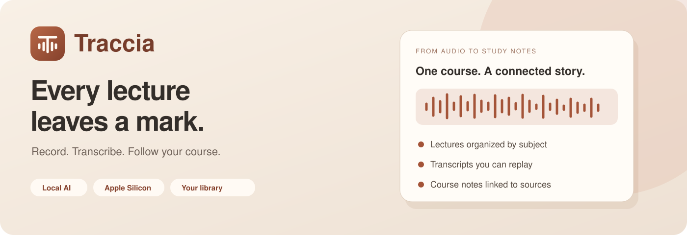
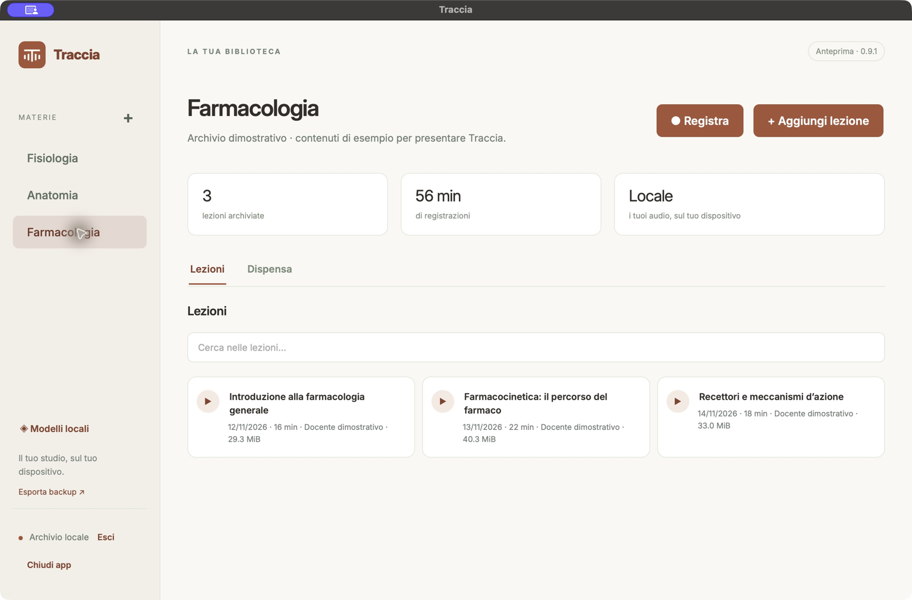
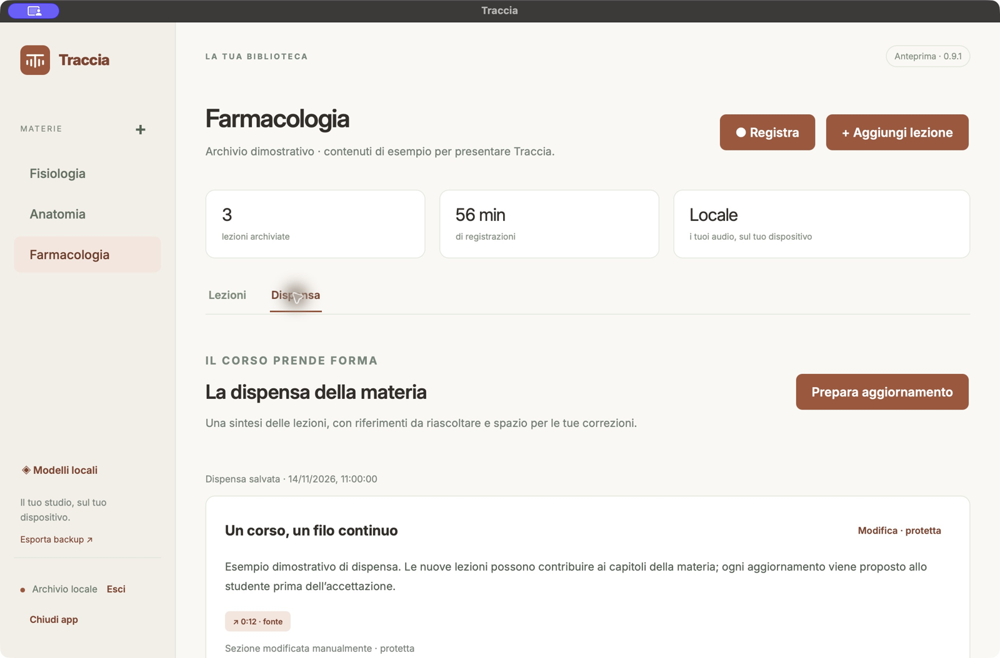

<div align="center">



### Il tuo assistente per le lezioni universitarie. Sul tuo computer.

Audio più chiaro, trascrizioni con timestamp e dispense che crescono con il corso.

**[Inizia](#inizia-con-traccia)** · **[Funzioni](#cosa-puoi-fare)** · **[Documentazione](docs/getting-started.md)** · **[Roadmap](docs/roadmap.md)** · **[Segnala un problema](https://github.com/ico88/aulalocale/issues)**

[](#stato-del-progetto)
[](#inizia-con-traccia)
[](#i-tuoi-audio-restano-tuoi)

**Italiano** · [English](README.en.md)

</div>

---

Una cartella piena di registrazioni non è ancora materiale di studio. **Traccia riunisce il percorso che viene dopo la lezione**: organizza gli audio, migliora l’ascolto, trascrivi e costruisci la dispensa della materia, tornando alle fonti quando serve.

I modelli lavorano sul Mac o sul server che scegli tu. Nel percorso standard non servono account, abbonamenti o token di inferenza.

> **Anteprima 0.9.1 · sviluppo attivo.** Il codice aggiornato è nel ramo [`sviluppo`](https://github.com/ico88/aulalocale/tree/sviluppo). Le funzioni IA richiedono revisione; i pacchetti Mac di sviluppo non sono ancora notarizzati.

<p align="center">
  
  <br><sub>La biblioteca di Traccia su Mac. Archivio dimostrativo con contenuti di esempio, senza lezioni personali.</sub>
</p>

## Cosa puoi fare

| | Dal parlato al materiale di studio |
|---|---|
| **🎙️ Registra o trascina** | Importa MP3, WAV, M4A e FLAC oppure registra dal microfono, con pausa e recupero dei blocchi già salvati. Titolo, data e docente possono essere proposti dal nome del file e dai tag audio. |
| **🎧 Riascolta meglio** | Riduci il rumore con GTCRN, regola il guadagno e confronta originale e versione migliorata dallo stesso punto. L’originale resta conservato. |
| **✍️ Trascrivi e correggi** | Whisper Turbo genera testo con timestamp. Cerca un termine, riascolta il passaggio, correggilo e salva una nuova revisione. |
| **📚 Fai crescere la dispensa** | Aggiungi una lezione alla materia e prepara una proposta di aggiornamento per argomento. Controlla le modifiche e i riferimenti prima di accettarla; le correzioni personali sono protette. |
| **🔎 Torna alla fonte** | I riferimenti della dispensa collegano il testo ai passaggi delle lezioni. Le revisioni aiutano a conservare il contesto delle correzioni. |
| **🖼️ Completa ed esporta** | Aggiungi immagini con didascalie, genera una mappa dei capitoli, esporta in Markdown o ZIP e stampa/salva in PDF. Backup e ripristino includono gli originali. |

**Strumenti audio sperimentali:** distingui i parlanti e assegna i ruoli, oppure prova a isolare il docente con VoxLock usando 3–30 secondi della sua voce. La qualità dipende dalla registrazione: [funzionamento e limiti](docs/audio-desktop.md).

## Una materia, una dispensa che cresce

La lezione successiva aggiunge qualcosa al corso. Anche i tuoi appunti dovrebbero poterlo fare.

1. **Aggiungi la lezione** alla materia e prepara la trascrizione.
2. **Rivedi i passaggi** cercando i termini e tornando all’audio.
3. **Prepara l’aggiornamento** della dispensa: Traccia propone integrazioni nei capitoli pertinenti e segnala possibili contrasti.
4. **Scegli cosa conservare**: controlla le fonti e conferma ogni sezione nuova o aggiornata. I tuoi interventi manuali restano protetti.

<p align="center">
  
  <br><sub>Schermata reale dell’app con testi dimostrativi inseriti manualmente. Non è un esempio di qualità della sintesi IA.</sub>
</p>

Il consolidamento tematico è sperimentale. Un riferimento permette di verificare la fonte, ma non certifica da solo la correttezza della sintesi. [Come funzionano le dispense →](docs/dynamic-notes.md)

## I tuoi audio restano tuoi

- **Inferenza sul tuo hardware.** Audio, trascrizioni e campioni vocali non vengono inviati a servizi IA esterni.
- **Modelli a scelta.** Scarica soltanto quelli che ti servono da Hugging Face o dalle release ufficiali. Dopo il download puoi elaborare offline.
- **Originali conservati.** Pulizia e isolamento creano derivati separati; correzioni e dispense usano revisioni.
- **Archivio esportabile.** Backup ZIP verificato con SHA-256; ripristino in una nuova cartella.

L’accesso a Internet serve per installare dipendenze e scaricare i modelli. Le bozze di registrazione ancora aperte non sono incluse nel backup: prima completale e salvale come lezioni.

## Inizia con Traccia

### Mac Apple Silicon

L’app si apre in una **finestra Mac dedicata**, con icona e controlli propri. La modalità browser rimane disponibile per chi preferisce il servizio web.

Per ora il percorso riproducibile pubblico è l’avvio da sorgenti: **non è ancora pubblicata una release Mac stabile scaricabile da questo repository**.

Servono **Python 3.11+**, Git e i **Command Line Tools di Xcode** per compilare i runtime.

```sh
git clone --branch sviluppo https://github.com/ico88/aulalocale.git
cd aulalocale
python3 -m venv .venv
source .venv/bin/activate
python -m pip install -r requirements-dev.txt
python -m pip install cmake==4.4.4
python scripts/setup_runtimes.py
python -m aulalocale
```

Al primo avvio crea una materia, apri **Modelli locali** e scarica i motori necessari. I pesi non vengono scaricati automaticamente. Per generare il pacchetto `.app` e il DMG, segui la [guida Mac](docs/getting-started.md#pacchetto-mac-di-sviluppo).

**Ambiente di riferimento:** Apple M4 con 24 GB di memoria unificata. Mac Intel esclusi; non sono ancora certificati requisiti minimi per altri dispositivi.

### Server proprio

Puoi usare Traccia via interfaccia web, con elaborazione sul server. Sono predisposti Dockerfile e Docker Compose; **build container, accesso remoto HTTPS e prestazioni sull’i7 / 24 GB sono ancora da verificare**. Questa anteprima usa un archivio per singolo utilizzatore. [Configurazione e limiti →](docs/getting-started.md#server-proprio)

## I motori dietro Traccia

| Motore | A cosa serve | Download indicativo | Licenza dichiarata upstream |
|---|---|---:|---|
| [Whisper Large v3 Turbo Q8](https://huggingface.co/ggerganov/whisper.cpp) | Trascrizione multilingue, italiano prioritario | 874 MB | MIT |
| [GTCRN](https://github.com/Xiaobin-Rong/gtcrn) | Riduzione del rumore | 523 KiB | MIT |
| [Qwen3 4B Q4_K_M](https://huggingface.co/Qwen/Qwen3-4B-GGUF) | Proposte di dispensa | 2,50 GB | Apache-2.0 |
| [pyannote + 3D-Speaker](https://github.com/k2-fsa/sherpa-onnx) | Analisi dei parlanti, sperimentale | 41 MB, due asset | MIT / Apache-2.0 |
| [VoxLock](https://huggingface.co/arbazsiddiqui/voxlock) | Estrazione della voce, sperimentale | 73 MB compressi, due asset | Apache-2.0 |

Revisioni e checksum dei pesi sono fissati nel [catalogo](aulalocale/models.py). L’inferenza usa whisper.cpp, llama.cpp e sherpa-onnx; FFmpeg gestisce conversione e controllo del volume. Un modello mancante non attiva un servizio cloud di ripiego.

## Stato del progetto

**Disponibile in `sviluppo`:** archivio, registrazione, pulizia IA, trascrizioni correggibili, proposte di dispense incrementali, immagini, esportazione e backup. Diarizzazione e isolamento della voce sono disponibili come strumenti sperimentali.

**Da completare:** qualificazione su più lezioni reali, trascrizione durante la registrazione, estrazione delle figure dalle slide/PDF, illustrazioni generative, multiutenza e distribuzione Mac firmata/notarizzata. [Roadmap completa →](docs/roadmap.md)

Le verifiche documentate includono **82 test backend** e prove dei motori reali sul M4. I test non costituiscono una garanzia di accuratezza sul lessico del tuo corso. Microfono fisico e permessi richiedono ancora prova manuale. [Risultati e limiti →](docs/verification.md)

## Partecipa

Stiamo costruendo Traccia per chi studia ogni giorno tra lezioni, registrazioni e appunti. Sono utili feedback sul flusso di studio, segnalazioni riproducibili e confronti sulla qualità audio.

- **Hai trovato un problema?** [Apri una issue](https://github.com/ico88/aulalocale/issues/new) indicando versione, dispositivo e passaggi per riprodurlo.
- **Hai un’idea?** Racconta quale parte del tuo studio migliorerebbe, prima della soluzione tecnica.
- **Vuoi contribuire al codice?** Leggi [CONTRIBUTING.md](CONTRIBUTING.md) e lavora su `sviluppo`. La licenza del progetto è ancora da scegliere: concordiamo prima i contributi esterni sostanziali.
- **Ti interessa il progetto?** Una ⭐ aiuta altre persone a scoprirlo.

Non pubblicare nelle issue registrazioni personali, trascrizioni delle lezioni, token o altri dati riservati.

<details>
<summary><strong>Documentazione, compatibilità e licenze</strong></summary>

- [Installazione, API, backup e build Mac](docs/getting-started.md)
- [Audio, registrazione e parlanti](docs/audio-desktop.md)
- [Dispense dinamiche](docs/dynamic-notes.md) · [Architettura](docs/architecture.md)
- [Confronti tra motori ASR](docs/model-selection.md) · [Verifiche](docs/verification.md)
- [Roadmap](docs/roadmap.md) · [Identità visiva](branding/README.md)

Traccia si chiamava **AulaLocale**. Il nome del repository, il modulo `aulalocale`, le variabili `AULALOCALE_*`, l’identificatore Mac e i percorsi dei dati restano compatibili: le lezioni esistenti non vanno reimportate.

Il repository è pubblico; la **licenza del codice deve ancora essere scelta**. Non viene quindi presentato come software già rilasciato con licenza open source. Modelli e dipendenze conservano le proprie condizioni, incluse quelle di Mutagen/FFmpeg, da verificare prima della distribuzione del prodotto.

[VoiceStudio](https://github.com/debpalash/voicestudio) ha ispirato l’attenzione all’installazione e ai modelli locali. Traccia è un progetto indipendente e non ne incorpora il codice.

`sviluppo` contiene il lavoro corrente. Le promozioni su `main` richiedono conferma esplicita; non è attivo l’auto-merge.

</details>

---

<p align="center"><strong>Traccia · Ogni lezione lascia il segno.</strong><br><sub>Un progetto per trasformare le registrazioni in un percorso di studio.</sub></p>
